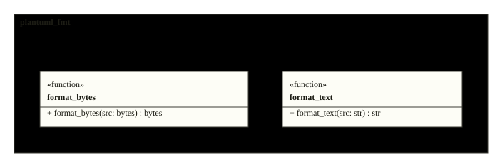
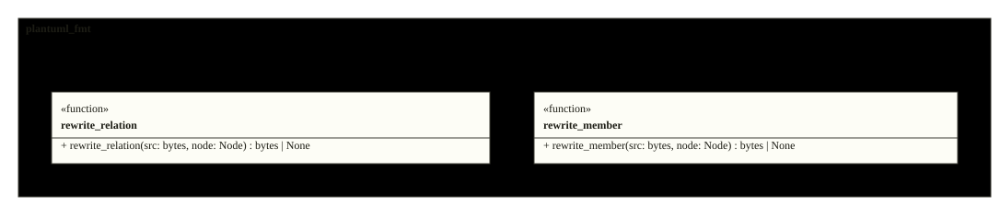

# Architecture

The formatter is three pieces: the CLI walks files, the Formatter decides
which lines it may touch (freezing opaque content), and the Rules rewrite
relations and members token by token. The figures below are the repository's
actual design, rendered from its sources on every inject.

<!-- folio: design --assets assets -->
### System view

#### HLD_PlantumlFmt

_hld · `design/hld/HLD_PlantumlFmt.puml`_

- traces to: `SREQ-00001-1`

### Module overview

#### CL_PlantumlFmt

_cl · `design/lld/plantuml_fmt/CL_PlantumlFmt.puml`_

- traces to: `REQ-00001-1` `REQ-00002-1` `REQ-00003-5` `REQ-00004-1` `REQ-00005-1` `REQ-00006-1` `REQ-00007-2` `REQ-00008-1` `REQ-00009-1` `REQ-00012-1`
- implemented in: `src/plantuml_fmt/cli.py` · `src/plantuml_fmt/formatter.py` · `src/plantuml_fmt/rules.py`
- verified by: `tests/test_cli.py` (2) · `tests/test_formatter.py` (9) · `tests/test_hooks.py` (1) · `tests/test_member_style.py` (12) · `tests/test_system_corpus.py` (1) · `tests/test_v2.py` (3)

### Class detail

<code>CL_Formatter</code> · traces to <code>REQ-00001-1</code> <code>REQ-00002-1</code> <code>REQ-00003-5</code> <code>REQ-00004-1</code> <code>REQ-00009-1</code> <code>REQ-00010-1</code>

<ul>
<li>source: <code>design/lld/plantuml_fmt/CL_Formatter.puml</code></li>
<li>implemented in: <code>src/plantuml_fmt/formatter.py</code></li>
<li>verified by: <code>tests/test_formatter.py</code> (7), <code>tests/test_system_corpus.py</code> (1), <code>tests/test_v2.py</code> (5)</li>
</ul>

<code>CL_Rules</code> · traces to <code>REQ-00003-5</code> <code>REQ-00007-2</code> <code>REQ-00008-1</code> <code>REQ-00011-1</code> <code>REQ-00012-1</code>

<ul>
<li>source: <code>design/lld/plantuml_fmt/CL_Rules.puml</code></li>
<li>implemented in: <code>src/plantuml_fmt/rules.py</code></li>
<li>verified by: <code>tests/test_cli.py</code> (1), <code>tests/test_cpp_members.py</code> (15), <code>tests/test_formatter.py</code> (3), <code>tests/test_member_style.py</code> (12), <code>tests/test_system_corpus.py</code> (1), <code>tests/test_v2.py</code> (3)</li>
</ul>

<code>CL_Cli</code> · traces to <code>REQ-00005-1</code> <code>REQ-00006-1</code>

<ul>
<li>source: <code>design/lld/plantuml_fmt/CL_Cli.puml</code></li>
<li>implemented in: <code>src/plantuml_fmt/cli.py</code></li>
<li>verified by: <code>tests/test_cli.py</code> (1), <code>tests/test_hooks.py</code> (1)</li>
</ul>

<!-- /folio -->
